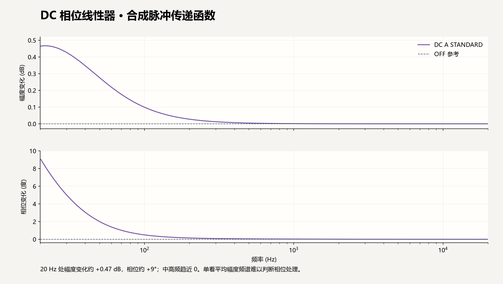

# Sony 三项音效的实际输出测量 · 2026-10-08

本轮使用同一段十秒无损 ALAC 的原生解码结果，分别生成全部关闭、全部开启，以及只开 DSEE AI、只开 DC 相位线性器、只开黑胶处理器的输出。开启参数为 DSEE AI、DC Type A / Standard（2）、Vinyl Standard（1）。实际执行固定哈希的 Sony 原模型与 x86 C++ 转写内核；九个原文件和编译 DLL 均先校验。

音乐与生成的 WAV 留在忽略的本机验证目录，不进入源码、EXE 或固件研究副本。用户要求的音乐频谱图以 PNG／PDF 保存在本机 `release/sony-spectrum/`；该目录不进入 Git。以下只记录方法和汇总数值，文档图片使用合成脉冲。

## 全开与全关

原始输入为 44.1 kHz、双声道、441,000 帧；三项全开后为 176.4 kHz、1,764,000 帧，时长仍为十秒。本次三个工作进程处理约 1.40 秒；只开 DSEE 约 1.30 秒，只开相位约 0.29 秒，只开黑胶约 0.34 秒。耗时来自这一片段和这台主机，不代表所有曲目的固定性能。

频谱使用 Hann 窗的 Welch 平均功率谱密度：窗口时长约 0.18576 秒、重叠 50%，44.1 kHz 使用 8,192 点，176.4 kHz 使用 32,768 点，频率分辨率相同。排除开头一秒及结尾半秒，先对左右声道功率求平均，使用同一绝对 dBFS/Hz 标尺；没有把每条曲线分别归一化或拉到相同峰值。全关文件在 22.05 kHz 以上没有可表示的频谱，图中不虚构这些数据。

| 输出 | 采样率 | 峰值，满刻度为 1 | RMS |
| --- | ---: | ---: | ---: |
| 全部关闭 | 44.1 kHz | 0.624939 | 0.058538 |
| 三项全开 | 176.4 kHz | 0.637778 | 0.059992 |
| 仅 DSEE AI | 176.4 kHz | 0.631260 | 0.058658 |
| 仅相位模式 2 | 44.1 kHz | 0.623828 | 0.059402 |
| 仅黑胶模式 1 | 44.1 kHz | 0.624458 | 0.059063 |

所有输出均为有限浮点样本，帧数和时长匹配。相位及黑胶各自与全关输出逐样本相减的 RMS 分别为 0.002476、0.003655，说明它们确实改变了实际输出。全开与单项频谱也有相应差异；高频能量增加本身不能证明音质更好，也不能证明源文件是 Hi-Res。

## 相位测量

相位器不能只用平均幅度频谱判断。另生成 65,536 帧、44.1 kHz 双声道脉冲，第 512 帧左声道为 0.25、右声道为 -0.125，其余为零；测量模式 2 输出与原脉冲 FFT 的比值。20 Hz–20 kHz 内最大幅度变化约 0.467 dB、最大相位变化约 9.030°；中高频趋近零。

测量发生在解码／音效输出端、进入音频设备之前，未包含 Windows 混音器、DAC 或模拟耳机输出。相位器左右独立历史的隔离另有 [24 组原单声道对照](SONY-PHASE-VERIFICATION.json)，本次 EXE 自检重新运行了该检查。

## 原版执行证据与适用输入

频谱作为输出变化的证据，结合 [246 组 PCM 和内部状态逐位对照](SONY-X86-VERIFICATION.json)及固定原组件哈希判断原版算法确实执行。本次测量使用的 `sony-dsp-x86.dll` SHA-256 为 `f5aa02c1dd93e209c88080a96b4ec141a2cf27fc382b613d4600b0d94c43e4db`，与上述 ARM 对照时相同。

DSEE 原版支持 44.1／48 kHz 输入；192 kHz 原音源旁路这一项，继续保留原采样率并执行支持该采样率的 DC／黑胶。原生 DSD 和 DoP 旁路这三项；DSD 转 PCM 后可以处理。界面的技术标志按照当前实际处理链显示，不能把设定开关等同于所有输入下都生效。

Sony 音效由 `Sony Corporation` 提供，DSEE、S-MASTER 是 `Sony Corporation` 的商标。

© 2026 Sony Corporation
