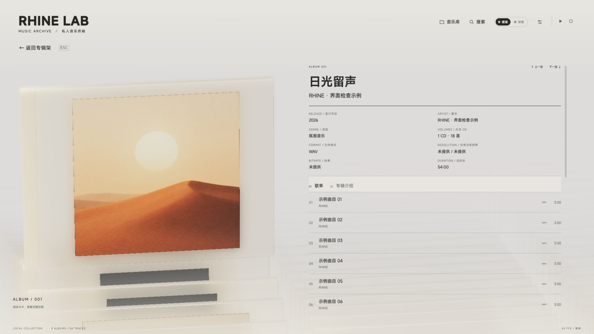
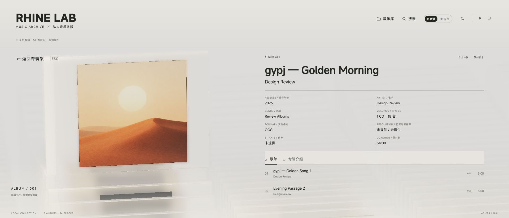
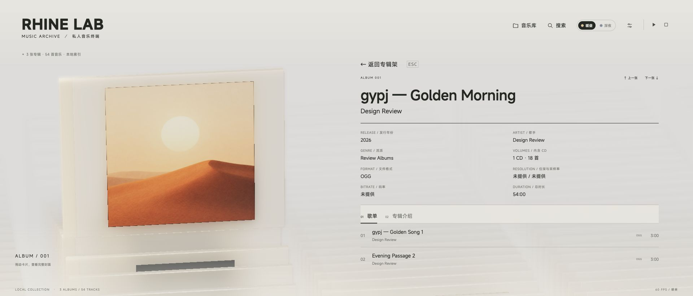
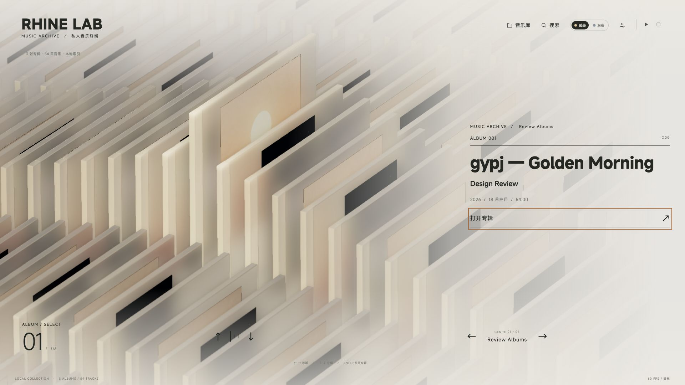

# V0.3.0 界面回归记录

本文件按修订时间保留实际验证与历史记录。当前 Windows 私有增强版的结果见下一节；2026-09-30 的 macOS 界面检查和 2026-10-01 的原发行检查属于历史，发布记录见 [RELEASE-V0.3.0.md](RELEASE-V0.3.0.md)。

## Liquid Glass 播放条（2026-10-09，当前 EXE）

当前单文件 EXE 为 231,349,760 字节，SHA-256 `f996d4cd2f4fdaaeb9ec3eb29338eb36da6a675ce278b05092c9b3150e52b4e0`。本节直接运行这个包；后面的 5a9d、8119 修订分别保留当时的证据。完整匿名汇总见 [Windows 验证 JSON](WINDOWS-ENHANCED-VERIFICATION.json)。

底栏改为 Apple Music 控制分组的浮动胶囊，左侧切歌／播放，中间原封面、歌曲与进度，右侧音量和当前曲目入口；图标使用固定 SVG 容器与块级绘制，播放／暂停共用同一中心，居中铁律写入 [Memory.md](../Memory.md)。横屏是 80px 单行，Pad 竖屏为约 112px 双行；每个按钮与滑条至少 44px。亮暗主题中实测播放与暂停状态的 SVG 中心偏差小于 0.01 CSS px。

玻璃使用本项目独立编写的圆角距离场、透镜折射、柔化采样、边缘色散与高光；直接读取三维场景现有最终输出纹理，合并进 Three.js OutputPass，不增加场景重绘、WebGL 上下文或离屏目标，不在应用中回读像素。底色遮罩仅在播放条形状内开窗，保留周围正文渐变。流光、按压反馈、图标切换、进度与封面交替采用线性时间；减少动态效果时光效停止而全部控制仍可用。

参考 [Apple 官方 Liquid Glass 说明](https://developer.apple.com/videos/play/wwdc2025/219/)的光学和控制分层原则。用户提供的 [wcKSRD](https://www.shadertoy.com/view/wcKSRD)、[3cdXDX](https://www.shadertoy.com/view/3cdXDX) 在本次研究中返回 402，未取得或复制其源代码；没有打包 Apple 框架或称为 Apple 原生材质。

| 实际 CSS 内容尺寸 | 主题／布局 | 底栏高度 | 结果 |
| --- | --- | --- | --- |
| 1267 × 804 | 暖昼／横屏 | 80.0px | 居中、44px 触摸、正文及统计无遮挡 |
| 1267 × 804 | 深夜／横屏 | 80.0px | 居中、44px 触摸、正文及统计无遮挡 |
| 727 × 794 | 暖昼／竖屏 | 111.6px | 居中、44px 触摸、正文及统计无遮挡 |
| 727 × 794 | 深夜／竖屏 | 111.6px | 居中、44px 触摸、正文及统计无遮挡 |
| 1027 × 794 | 深夜／横屏 | 80.0px | 居中、44px 触摸、正文及统计无遮挡 |
| 1387 × 804 | 深夜／横屏 | 80.0px | 居中、44px 触摸、正文及统计无遮挡 |

使用 Electron 主进程调整实际窗口，zoom factor 为 1、DPR 为 1.25，没有设备视口覆盖。六组截图都记录截图时的实际尺寸；触摸由 CDP 模拟，未接入实体 Pad。页面与 shader 错误均为零。

[玻璃播放条·暖昼](media/v0.3.0/sony/liquid-glass-day.png) · [深夜](media/v0.3.0/sony/liquid-glass-night.png) · [Pad 暖昼](media/v0.3.0/sony/liquid-glass-pad-day.png) · [Pad 深夜](media/v0.3.0/sony/liquid-glass-pad-night.png)

通过真实窗口的 GPU uniform 验证透镜矩形跟随尺寸与圆角、昼夜色调正确、边缘时钟持续推进、触摸使高光升起并归零；减少动态效果后时间与交互光均归零、CSS 动画停止。冻结场景并临时关闭／恢复同一个透镜 uniform，播放条内约 95.9% 像素变化，平均通道差 24.94/255，条外平均差 0.000/255，确认 GPU 效果实际生效。诊断截图比较仅用于测试，不是应用运行时像素回读。

在同一 RTX A4500／ANGLE D3D11、实际 1266 × 779 内容尺寸、DPR 1.25 下，旧 5a9d EXE 与本包各做八段六秒测量。最高画质保留 100% 渲染比例、SMAA、4096 阴影、32 次 AO、完整景深和透射；使用合成静音 PCM，Sony 关闭，单独测绘制负担。

| 场景 | 旧版 FPS | 当前 FPS | 当前 P99 帧间隔 |
| --- | --- | --- | --- |
| scroll-array | 97.31 | 97.81 | 10.20ms |
| playing-bar | 99.65 | 99.65 | 10.20ms |
| theme | 99.65 | 99.48 | 10.20ms |

播放条启用时两包均为 46 次 Three.js draw call，当前六秒采样中没有超过 50ms 的帧。滑动阵列仍各出现一次约 120ms 的长帧，保留在原始记录中，未声称完全消除所有场景停顿；其他 GPU 或整库的性能未由此保证。

同一最终 EXE 的 21 项操作覆盖 Sony 三项原版处理及 176.4 kHz 输出、播放／暂停刷新、排序／扫描刷新、触摸预览／单次提交／取消、键盘跳转、音量恢复、切歌／停止、当前曲目入口和曲库移除停止后端。FiiO 的平衡静音 DSD64 原生／DoP 再次检查播放及暂停恢复、60／30 秒跳转与 DAC 音量锁定。没有进行真实原始 DSD 听音或模拟输出测量。

音乐核心 61 项通过（3 项平台跳过）、播放器 18 项、展示 21 项、音频 30 项、原生 13 项、Hi-Res／DSD 6 项、内容 18 项，以及视口、场景／动效／相机／灯光／玻璃、TypeScript／Vite／PWA 构建通过。最终包六项隔离自检通过，冷启动含自检 5.500 秒；系统 PATH 只含 Windows System32，不依赖外装 Node／Python／Unicorn／FFmpeg。117 个分发文件与实际运行副本逐字节核对，Sony 原文件及 x86 DLL 哈希不变；24 组相位隔离与三效果链重验，246 组完整 ARM 对照未重复。前一修订的音乐频谱继续见 [测量记录](SONY-AUDIO-MEASUREMENTS.md)，明确保留其测量版本。

## 播放进度与前端会话恢复（2026-10-08，早期 5a9d 修订）

这一早期修订的单文件 EXE 为 231,345,152 字节，SHA-256 `5a9d53aff0227405898b98a63cd90c8d9ccc700e7aba3c2a9650bdec14ca7a2e`。本节直接测试此包；后面 8119 修订的真实歌曲和性能测量保留为历史，没有当作此包重新测得的结果。当前汇总见 [Windows 验证 JSON](WINDOWS-ENHANCED-VERIFICATION.json)。

扫描完成和排序原先调用页面刷新，独立原生音频仍播放，新页面却没有当前歌曲。现在新页面先接回后端会话，用曲库与本页保存的队列恢复歌曲、位置、播放／暂停、设定音量及 Sony 处理信息；不重新打开音频或清空已有原版滤波状态。每个页面有自己的控制标识，旧页面的迟到请求及未完成的打开不能覆盖或停止已恢复的播放。设定音量独立于淡入淡出的临时增益，恢复后不会停留在半音量。无法从索引恢复的曲目会停止后端输出并提示。

底部加入歌曲、状态、已播／总时长、触摸进度、上一曲／下一曲和音量。拖动先预览，松手只跳转一次；取消手势不跳转，暂停跳转保持暂停。Sony 已生成区段同步显示；恢复后的暂停会话仍更新未完成的处理进度而不推进歌曲时间。DSD 原生／DoP 音量锁定并显示 DAC。打开设置时底栏进入 inert，关闭后恢复；详情下边界为底栏留出空间，英文统计仍可见。

隔离示例库直接启动 EXE，只保留系统目录 PATH，不依赖系统 Node／Python／FFmpeg。实际操作覆盖播放中刷新、37 秒暂停位置刷新、排序刷新、扫描完成刷新、25% 音量恢复、切歌和停止；恢复保持同一后端会话并且没有新的音频打开请求。FiiO ASIO 另用平衡静音 DSD64 验证原生和 DoP 的播放／暂停恢复、60／30 秒触摸跳转及 DAC 音量锁定。清空测试曲库触发扫描刷新后，不可恢复的曲目停止后端，前端没有残留播放。共 18 项窗口检查，页面与 shader 错误均为零，窗口正常退出。

| 实际 CSS 内容尺寸 | 主题／布局 | 控制条与正文 |
| --- | --- | --- |
| 1267 × 804 | 暖昼／横屏 | 72px 底栏，正文与统计不遮挡 |
| 1267 × 804 | 深夜／横屏 | 同样布局，主题颜色跟随 |
| 727 × 794 | 暖昼／竖屏 | 约 108px 双行底栏，详情可滚动 |
| 1027 × 794 | 深夜／横屏 | 72px 底栏，无横向溢出 |

窗口通过 Electron 主进程调整实际尺寸，zoom factor 为 1、DPR 为 1.25；没有固定设备视口模拟。按钮和滑条均至少 44px；触摸是 CDP 输入模拟，未接入真实 Pad。

[底部播放控制·暖昼](media/v0.3.0/sony/playback-progress-day.png) · [深夜](media/v0.3.0/sony/playback-progress-night.png) · [Pad 竖屏](media/v0.3.0/sony/playback-progress-pad.png)

Sony 三项全开／全关及逐项实际音乐输出频谱、合成脉冲相位测量见 [测量记录](SONY-AUDIO-MEASUREMENTS.md)。三项全开输出 176.4 kHz；相位和黑胶单项与关闭输出均有可测差异。谱图采用同一绝对标尺；不能仅凭高频能量声称音质更好。真实音乐、生成的 WAV、封面缓存及音频指纹未进入源码或研究副本。

本次音频 30 项、原生 13 项、Hi-Res／DSD 6 项、播放器 18 项、曲库核心 61 项通过（3 项平台不适用跳过）、展示 21 项、内容 18 项，以及视口／场景／动效／镜头／灯光／玻璃／TypeScript／Vite 构建通过。最终包六项隔离自检通过，含 24 个相位隔离组合及三项原版内核，冷启动含自检 5.074 秒。Sony DLL 保持与原 246 组 ARM 逐位对照相同，本轮没有重复全量 246 组。

## 192 kHz、FiiO、动画卡顿及 DSD 双标志（2026-10-08，早期 8119 修订）

这一早期修订的单文件 EXE 为 231,340,544 字节（220.6 MiB），SHA-256 `811964cc38b5dd6c29baaabcf56814e685667d1011b2349e2dcd81ee286c71c6`。下面的窗口、真实文件播放和最终性能检查直接启动这一包，使用各自的隔离用户目录；没有改动个人偏好、曲库配置或歌曲标签。历史节中的旧包哈希、软件渲染帧率、模拟视口尺寸和“尚无 ASIO 设备”不代表当前包。去除本机路径、会话、音乐指纹与凭据的汇总见 [Windows 验证 JSON](WINDOWS-ENHANCED-VERIFICATION.json)。

### 24 bit／192 kHz 与实际音频

旧 MP4 音频描述字段把提供的 ALAC 错报成 16 bit／1 Hz，既影响 Hi-Res 判定，也使处理请求使用错误参数。现从 ALACSpecificConfig 读取真实位深与 32 位采样率，元数据版本升至 4，重扫升级旧索引，FTP 已缓存文件也在读取时更新。自动化夹具含同样的错误描述字段及正确的 24／192 配置，并检查边界、截断和旧缓存升级。

只读检查用户授权的 9 首 ALAC，全部识别为 24 bit／192 kHz／双声道；每首前 8,192 帧原生浮点输出与 FFmpeg 对照一致，合计 73,728 帧。14 首 DSF 全部识别为 1 bit／2.8224 MHz DSD64；每首前 16,384 字节原始输出与 DSF 的声道解交错、LSB → MSB 载荷一致，合计 229,376 字节。23 个文件的大小与修改时间未变化；真实音乐、片段、封面缓存和 PCM 指纹留在隔离验证目录，没有进入源码、文档图片或固件研究副本。

最终 EXE 用原文件在 FiiO ASIO 上实际播放 192 kHz ALAC，零音量下输出位置前进；启用相位模式 2／黑胶模式 1 后仍为 192 kHz，显示对应两项标志。Sony 原版 DSEE 仅支持 44.1／48 kHz 输入，因此在 192 kHz 逐项旁路并说明原因，保留原采样率；只开 DSEE 时直接播放原文件，不创建无效处理任务。原相位和黑胶支持 176.4／192 kHz，继续实际计算。独立原生验证从真实曲目的 388 秒处处理，约 0.92 秒有首缓冲。

流式解码还修复了非阻塞管道背压时成功但写入零字节造成的提前失败：分块写入、有限等待并报告真正的系统错误。12 秒 192 kHz 回归在消费者暂停 300ms 后仍精确输出 2,304,000 帧，没有丢帧。进程 JSON 使用明确的 UTF-8，避免分块中文或 Windows 代码页破坏错误信息。

真实文件窗口测试把两个授权音乐文件夹直接作为索引根目录，因此按既有规则生成 23 个独立单曲专辑。窗口分别检查一个 ALAC 和一个 DSF 单曲的专辑／曲目标志及金边；没有为了测试改写原来的分组规则。全多曲专辑和混合专辑的行为由下述合成示例库覆盖。

### 已接入 FiiO ASIO

查询到 `FiiO ASIO Driver`、两个输出通道，格式为 32 位容器中的 24 位 PCM；实际驱动接受查询的 PCM 时钟为 44.1、48、88.2、96、176.4、192、352.8、384 kHz，原生 DSD 时钟为 2.8224、5.6448、11.2896 MHz。查询能力不等于已完成各采样率的播放验证，也没有从通用驱动名称推断 Q1 的具体代际。

原先原生 DSD 的隐式通道绑定被驱动拒绝，改为显式设置 DSD MSB 通道格式、立体声关联与原始载荷回调。硬件验证包含真实 192 kHz PCM 的播放／暂停／跳转／停止，以及平衡 `0x69` 静音载荷的 DSD64 原生／DoP 同组操作。原生与 DoP 的音量锁定，DSP／增益／淡入淡出旁路。真实 DSF 另做原生打开及 120 秒跳转，没有播放实际音乐的原始 DSD 位流做主观听音；最终窗口验证真实 DSF 转 44.1 kHz PCM 的 ASIO 播放和源标志保留。

### 原比例、触摸及 DSD 标志

撤掉此前自动化施加在真实桌面窗口上的固定模拟视口，现通过 Electron 主进程调整实际窗口边界，不使用 `Emulation.setDeviceMetricsOverride` 或 `page.setViewportSize`。启动／刷新恢复页面 zoom factor 1，Windows 系统 DPI 缩放仍保留。把测试窗口临时设为 1.4 倍后刷新，实际恢复到 1；前端画质比例只控制渲染缓冲，没有参与页面缩放。

最终 EXE 四次真实窗口回归均用 CDP 触摸事件，DPR 为 1.25；下表为读取到的 CSS 内容尺寸，而非请求的窗口外框尺寸。主要控件与曲目至少 44px，Esc 始终在品牌下方，标志不遮标题、不超正文范围，没有水平溢出或页面／shader 错误。触摸仍为输入模拟，没有接入实际 Pad。

| 实际 CSS 内容尺寸 | 主题／布局 | 结果 |
| --- | --- | --- |
| 1267 × 804 | 暖昼／横屏 | 标题和曲目显示 Hi-Res＋DSD，金边启用，DSD 石墨色 |
| 1267 × 804 | 深夜／横屏 | 双标志及金边保留，DSD 银白色 |
| 727 × 794 | 暖昼／竖屏 | 双标志预留宽度，详情与设置可滚动，控件可触摸 |
| 1027 × 794 | 深夜／横屏 | 双标志、返回、播放和设置无重叠 |

用户提供的 `art/DSDlogo.svg` 与 `public/audio-tech/dsd.svg` 逐字节相同；使用透明 SVG 轮廓做遮罩，原背景保持透明。实际计算样式确认 DSD 反射为 `linear`，相隔 400ms 的变换不同；暖昼颜色为 `rgb(51, 58, 50)`，深夜为 `rgb(233, 238, 242)`。设置及系统减少动态效果均停止动画。源 DSD 转 PCM 后仍显示双标志，返回专辑架仍有双标志。全 DSD 专辑有两个专辑标志与金边；DSD／PCM 混合但全 Hi-Res 的四曲专辑只有 Hi-Res 专辑标志，DSD 曲目仍显示两个；含 CD 音质的混合专辑没有专辑标志或金边。

[DSD 暖昼](media/v0.3.0/sony/dsd-source-day.png) · [DSD 深夜](media/v0.3.0/sony/dsd-source-night.png) · [DSD Pad 竖屏](media/v0.3.0/sony/dsd-pad-portrait.png)

### 动画卡顿复现与修复

同一台 Windows 主机、RTX A4500／ANGLE D3D11、DPR 1.25、1266 × 779 CSS 视口、76 张合成专辑／80 首曲目。两包均使用 100% 渲染比例、SMAA、4096 阴影、32 AO 全分辨率、景深 100%、透射 100%、各向异性 16；有效渲染缓冲均为 1583 × 974。每项记录 6 秒的 requestAnimationFrame 时间，滚动包含 18 次间隔 200ms 的向下输入。各项平均 FPS 是这个测试窗口的结果。

| 操作 | 旧 EXE 平均 FPS | 当前 EXE 平均 FPS | 当前 P95 帧间隔 |
| --- | ---: | ---: | ---: |
| 专辑架静止 | 99.65 | 99.65 | 10.1ms |
| 滚动专辑阵列 | 12.97 | 97.14 | 10.1ms |
| 打开详情 | 5.40 | 98.48 | 10.1ms |
| 详情静止 | 99.65 | 99.65 | 10.1ms |
| 亮暗切换 | 99.65 | 99.48 | 10.1ms |
| 详情下一张 | 95.64 | 99.65 | 10.1ms |

旧封面刷新反复上传整个 108 MiB 图集，大型 GPU 2D 画布裁剪还产生回读。现图集常驻显存、合并上传变化区域，并为内部封面画布使用 CPU 像素存储；在 5.2 秒进场计时前预热玻璃、阴影与后处理，桌面优先使用独立显卡。没有降低用户画质或改变盒体／封面尺寸、48 个循环位置和相机终点。当前滚动仍记录到一个 120.4ms 长帧，打开详情一个 50.2ms 长帧；其余操作的最长帧为 10.2–20ms。修复反复停顿不构成所有 GPU 上零长帧的保证。

### 最终检查与覆盖范围

`check:audio` 27 项、`check:native` 11 项、`check:hires` 6 项通过。音乐主体 61 通过／3 Windows 平台跳过，播放器 15、呈现 21 项及场景／动效／相机／灯光／模型通过；内容 18 项、视口、TypeScript／Vite／PWA 通过。最终 EXE 只复制一个文件，PATH 限制为系统目录、没有系统 Node／Python／FFmpeg，六项隔离自检全部通过；冷启动含自检 5.502 秒，第二次复用展开缓存。Sony C++ 内核未改，246 组 ARM 完整输出／状态对照沿用其相同 DLL 的既有记录；最终包重新运行 24 组相位隔离和三效果处理。

DSD128／256 只查询驱动能力，没有播放；设备热拔插、长期稳定性、真实平板和全格式全库尚未覆盖。原始 DSD／DoP 数字载荷检查不代表物理 DAC 模式或模拟输出已经测量；Sony 对照针对软件 PCM 链路，不宣称重现 Walkman DAC 和放大器。固件研究副本同步当前源码、原版文件、固定哈希、DSD SVG 与去除私人信息的验证记录，不复制个人音乐或缓存。

## 前一轮 Hi-Res 标志、线性动画与玻璃金边（2026-10-08，历史记录）

使用用户提供的原 SVG，按 [JAS／JEITA 音源定义](https://www.jas-audio.or.jp/hi-res/definition)及 [Sony 对 DSD 的说明](https://www.sony.com/ja/SonyInfo/News/Press/201309/13-127/)判断原文件。实际夹具包含 24 bit／44.1 kHz、24 bit／48 kHz、16 bit／96 kHz、DSD64／128，以及混合和 CD 专辑。原文件条件、未知参数与 FTP 行为见 [Hi-Res 说明](HI-RES.md)。

最终独立 EXE 验证 768 × 1024 暖昼、1024 × 768 深夜、1280 × 800 暖昼／深夜。全 Hi-Res 专辑四首的曲目标志与标题右侧专辑标志均显示，透明盒左右金边启用；标志在正文范围内、与标题不重叠、页面无水平溢出。复用原 Blender 模型及 9 × 48 实例池，逐实例分配金色，不改面板或封面几何。

混合专辑只有符合的一首显示标志，没有专辑标志或金边；切到 CD 专辑全部清除，返回浏览时保留正确专辑标志。FTP 初始未知参数不标记，下载并读取两首原参数后，自动出现曲目／专辑标志与金边。浏览、详情、归还副本和亮暗主题切换均检查，没有观察到 WebGL shader 编译错误。

通过窗口计算样式与不同帧的画面检查实际动画：扫光和光晕的 timing function 均为 `linear`，反射位置随时间变化；设置减少动态效果后停止，系统减少动态效果也停止。低帧率软件渲染截图曾捕获主题过渡中间帧，额外在最终 EXE 等待文字和按钮的颜色及 CSS 过渡结束后，重新核对并截图暖昼／深夜金边；曲目文字和所选主题按钮颜色均达到对应主题值，扫光仍运转。专门判定检查 5 项、FTP 参数持久化及玻璃副本检查通过。尚未验证真实平板触摸或全部音源格式；文件参数标志不证明母带原生分辨率或设备认证。

[暖昼金边](media/v0.3.0/sony/hi-res-gold-day.png) · [深夜金边](media/v0.3.0/sony/hi-res-gold-night.png) · [Pad 竖屏](media/v0.3.0/sony/hi-res-pad-portrait.png) · [专辑架标志](media/v0.3.0/sony/hi-res-archive-night.png)

## Sony ARM → x86 C++ 与实时切换（2026-10-08，前一包历史记录）

本节为此前 Windows 私有增强包的实测。当前包见顶部新修订；下面 `2026-10-07` 的 ARM 性能、相位器未通过和局部 CReLU 记录保留为历史；完整 C++ 转写与声道隔离已完成。未提交、上传或公开发布。

转写 32,159 个原指令位置，生成 65 个代码页及调度文件。编译前与三个原 ELF 的代码字节逐一核对，九个 Sony 文件的 SHA-256 不变。生成器重建的 66 个 C++ 文件与源码逐字节相同。独立 Cortex-A7 ARM 实例与 x86 C++ 实例的 246 组完整 PCM 输出和全部已分配状态逐位一致，共 5,046,272 个输出值；各组参数、哈希和耗时见 [Sony C++ 对照](SONY-X86-VERIFICATION.json)。Windows 播放不执行 ARM 模拟器，Python 只编排分块／ABI／进程。

相位器左右声道原先共用历史。修正为各自初始化 Sony 原版上下文，并分别调用同一内核；未替换系数或滤波计算。六模式 × 四采样率共 24 组：双向串扰峰值均为 0；连续单声道原入口、不同分块及声道交换均逐位相同。见 [相位验证](SONY-PHASE-VERIFICATION.json)。

| 实测输入／条件 | 结果 |
| --- | --- |
| 授权曲库 ALAC 十秒片段，三效果串行 | ARM 18.22 秒 → C++ 3.31 秒，约 5.51 倍；音频及状态逐位相同，源文件未变 |
| 二十秒合成双声道，三进程，原生 WASAPI 静音 | 约 0.89 秒首缓冲，3.31 秒完成；未完成就起播，3,528,000 帧均有限，向未生成位置跳转通过 |
| 五分钟合成音频从 180.123 秒开始 | 首缓冲约 0.59 秒；更改预设约 0.67 秒；旧生产任务取消，完整时间轴保持 |
| 最终 EXE、SwiftShader 50% 渲染、触摸输入 | 观察到开始播放约 6.99 秒；播放中换预设约 0.66 秒；暂停后连续换两项、恢复原位置、顶部歌名定位详情均通过 |

原生管道按需解码，从当前播放位置开始，不先等待整首解码。约半秒音频即可起播。关闭边算边播仍等待完整结果。软件渲染的窗口负载与独立 DSP 测试不同，上述时间不是所有设备的保证。

额外验证生成 MP3、AAC、FLAC、48 kHz 单声道 WAV 和 AIFF：完整流式输出与文件解码字节相同，跳转后的帧数与时间轴相符，输出均有限。Media Foundation AAC 的最后编码帧可能包含超出容器声明时长的填充，现统一截到声明长度；0.237 秒 AAC 回归夹具加入日常检查，三效果输出 45,504 帧／192 kHz、时长不变。触摸检查还发现连续改预设会丢失暂停意图，现替换准备任务时保留原暂停与播放位置；专门回归已通过。

单文件 EXE：231,328,768 字节（220.6 MiB），SHA-256 `c6062ac7437809266b24d94a5aac35cd83e8aa64f368ca62c8aad40be7230b4d`。仅复制 EXE、PATH 限制为系统目录、移除本机运行环境变量后，六项自检均通过；包含 x86 C++ DLL 和九个原文件哈希、24 组相位检查、DSF ID3 与完整 raw DSD／DoP 字节、三效果处理及静音 WASAPI。冷启动含自检约 6.82 秒，第二次复用展开缓存。

窗口验证 768 × 1024 暖昼、1024 × 768 深夜、1280 × 800 暖昼／深夜的触摸、返回、滑尺、表单和 DSF 封面。主要控件至少 44px，未观察水平溢出。三种透明标志对应实际接入的效果；暂停停转，停止消失。Sony 设置显示 x86 C++、声道隔离通过及 `© 2026 Sony Corporation`。静音 FTP WAV／DSF 播放、DSF 中文标签与封面更新通过；歌曲流程中 HTMLMediaElement.play 调用为零。窗口实测 EXE 的 SHA-256 为 `70c8527b175f394051fb6d9799b23829a695d62967ff26d7ddf4ee3297f8a64a`；重新打包后的外层校验值改变，逐一核对 1871 个展开文件均与实测包字节相同。最终交付文件再次完成六项隔离自检及以下启动检查，两种包的哈希均保留在验证 JSON。

最终 EXE 在初始导航时反复刷新四次，同时占用 5175：恢复到 5176，原生组件就绪，偏好跨进程保存；触摸滑尺按实际 album ID 变化确认。退出码 0。检查：一键构建流程通过；后续针对 AAC／暂停修正及 Hi-Res 重新执行相关检查，原生 10 项、音频 24 项、Hi-Res 5 项、音乐主体 61 通过／3 平台跳过、内容 18 项、视口、TypeScript／Vite／PWA、打包及最终六项隔离自检通过。FTP 未带标签的首曲不会遮掉后续 DSF 提供的专辑信息，真实只读 FTP 夹具与窗口播放均验证此顺序。

[暖昼原生 Sony 播放](media/v0.3.0/sony/sony-x86-native-day.png) · [深夜原生 Sony 播放](media/v0.3.0/sony/sony-x86-native-night.png) · [当前 Sony C++ 设置](media/v0.3.0/sony/sony-x86-settings-night.png)

详细、去除本机路径／会话／凭据的 [Windows 验证 JSON](WINDOWS-ENHANCED-VERIFICATION.json)保存本节结果。真实音乐片段和其 PCM 指纹未放入公开说明、源码或固件研究副本。ASIO／DSD DAC、热拔插、真实 Pad／iPad、公网 FTP／实际 FTPS、全库与长期稳定性尚未验证。逐位对照针对已支持的 PCM 软件链路，未宣称重现 Walkman 的 DAC、放大器或整套固件。

固件目录的 `Extracted-Research-2026-10-07` 已保存本轮完整研究副本：九个原文件、C++ 源码、66 个生成文件、指令图、生成器、桥接和验证记录。复制后的源码汇总哈希与编译清单相同，32,159 个指令字节及 65 个代码页重新核对通过；直接从副本探测的三效果初始化与声道隔离也通过，后端为 `x86-cpp`。没有复制个人歌曲、片段、PCM 指纹或凭据。

## Windows 单文件 EXE、原生音频与 DSF ID3（2026-10-07，历史记录）

在上一节历史 macOS 发行基础上，按用户追加要求验证 Windows 私有增强版。本轮完整执行 `scripts/build-windows.ps1`：校验下载的便携 Node.js 26.7.0、Zig 0.15.2，重新编译 C++，安装依赖、执行检查、构建界面、打包与运行 EXE。双击入口是 `Build-Windows-EXE.cmd`，详细逐条命令已重写到 [README](../README.md)。未进行 Git 提交、上传或公开发布。

单文件 `Rhine Music.exe` 约 217.8 MiB（228,405,248 字节），自带 Electron 44.6.0／Node 24.21.0、Python 3.14.4／Unicorn 2.1.4、原生解码／ASIO 组件及九个 Sony 原版文件。最终 EXE SHA-256：`2110fccab8d5cb96dcfb1ea616d95732d121950c786fe487756c2728682a9181`。所有第三方许可与 Unicorn 对应源码归档随包保留，Sony 组件不改授 MIT。

### 隔离 EXE 与音频

只复制这一个 EXE 到含中文、空格的独立目录，PATH 限制为 `C:\Windows\System32`，移除本机 Python／Sony／音乐环境变量。五项自检全部通过：原生组件哈希与初始化；DSF 中文 ID3、封面及完整 raw／DoP 载荷；九个 Sony 哈希及原版 AI／DC／Vinyl 初始化；三进程原版处理及自带解码；静音 WASAPI 播放、暂停、跳转、停止。冷启动含自检约 5.06 秒，第二次复用同一展开缓存，无系统 Node／Python／FFmpeg 依赖。

原生独立回归 8 项通过，包括取消先于打开、过时会话、缓存读取租约、未完成音效输出跳转时仍可暂停、增长 WAV 提前起播和取消读取。DSF／DFF × DSD64／128／256 × 4098／8192／32768 字节每声道共 18 组合，完整 DSD 位序、声道与 DoP 0x05／0xFA 标记和全部载荷通过。发现并修正 BASSDSD 2.4.2 的 DSF 最后完整块漏读；C++ 使用只读容器视图，未改写音乐。

本地 DSF 使用实际尾部 ID3v2.3 UTF-16／ID3v2.4 UTF-8，验证中文标题、歌手、专辑及专辑歌手、曲号／碟号、采样率／时长及内嵌 PNG；扫描重载、HTTP 封面字节和源文件不变通过。加标签前后的原始 DSD 和 DoP 全载荷一致。FTP 只列目录，选曲下载后读取 DSF ID3 和封面；重扫、重启、清理缓存后保留文字信息，再下载恢复封面。元数据刷新不会重新打开、跳转或重启已暂停的输出。

另外只读选取用户授权曲库的一首 ALAC：44.1 kHz／16 bit／双声道，原生解码 262,144 字节浮点 PCM 全部有限，RMS 0.045806、峰值 0.337036；静音 WASAPI 播放时位置前进，读取前后源文件 SHA-256 相同。这个单曲探测不代表已扫描整库或覆盖全部编码。

原生三效果处理 20 秒生成校准音频，独立音频测试约 3.98 秒起播、18.48 秒完成；352.8 万帧全部有限，PCM SHA-256 为 `f388a7c93ef891df4f21d21822ebbed175c9f217dea7cf8c6903baf97d204085`。实际桌面窗口在 SwiftShader 负载下约 14.04 秒观察到播放，输出为 176.4 kHz，暂停位置约 6.21 秒保持，三项透明标志对应实际接入输出，停止后消失。二者负载不同，不作为通用实时保证。

### 桌面窗口、主题与触摸

从隔离目录的 EXE 启动真实 Electron 窗口，以 Playwright/CDP 驱动其自带渲染器；没有启动外部浏览器。设置为 50% 渲染比例，关闭阴影／AO／景深，使用 SwiftShader，约 1–10 FPS。以下为 CSS 像素视口；Windows 125% 缩放会使截图像素更大，不代表实际 Pad 面板尺寸。

完整窗口回归使用前一包，EXE SHA-256 为 `3cbb147e6cd452797a3951442ff84a5c6814556964bbc596c430f00142e5702a`。与最终包逐文件比较，90 个界面文件、15 个服务／Sony 桥接文件及原生音频源码哈希一致；最终包增加端口不可绑定时的顺延处理，并重新执行五项隔离自检及下述启动／触摸检查。

| CSS 视口 | 主题／输入 | 结果 |
| --- | --- | --- |
| 768 × 1024 | 暖昼／触摸 | DSF 中文标签及内嵌封面；Esc 在 22／164，主要控件至少 44px，无水平溢出 |
| 1024 × 768 | 深夜／触摸 | 返回在品牌下方，曲目及原生输出表单可操作，无水平溢出 |
| 1280 × 800 | 暖昼／触摸 | 原生输出／ASIO／DSD 设置、Sony 透明标志及可滚动详情通过 |
| 1280 × 800 | 深夜／触摸 | 相同功能，表单及标志颜色随主题切换 |

触摸采用 CDP touchStart／touchMove／touchEnd；包括返回、搜索选专辑及滑尺水平滑动。法律信息 `© 2026 Sony Corporation` 在 Sony 设置区暖昼、深夜实际显示。窗口内默认 WASAPI，选项仅 WASAPI／ASIO；未安装驱动时显示未找到 ASIO 驱动，DSD 原生／DoP 可选但不虚构硬件。静音本地 DSF 转 PCM、原版三效果和 FTP WAV／DSF 都实际播放；FTP DSF 的中文歌名、专辑和封面更新到界面。已观察的歌曲播放流程中 HTMLMediaElement.play 调用为零，音频位置来自 C++。

用户所见 `ERR_ABORTED (-3)` 起因是自动化在初次窗口加载未完成时刷新。程序现正确处理被刷新／关闭取消的导航，避免当作启动失败；自动化也等待可用页面后操作。最终 EXE 额外故意在加载中连续刷新四次，并占用 5175：窗口成功恢复到 5176，原生组件就绪，重启后深夜主题、零音量、WASAPI 及 Sony 并行／流式选择保留。768 × 1024 触摸搜索选专辑、返回及水平滑尺测试以实际 album ID 改变确认，窗口正常关闭退出码为 0。不可绑定端口也有顺延处理，但本次只实测端口占用。

[DSF Pad 竖屏](media/v0.3.0/sony/desktop-dsf-portrait-day.png) · [DSF Pad 横屏](media/v0.3.0/sony/desktop-dsf-landscape-night.png) · [原生设置暖昼](media/v0.3.0/sony/native-settings-day.png) · [原生设置深夜](media/v0.3.0/sony/native-settings-night.png) · [Sony 原生输出暖昼](media/v0.3.0/sony/native-sony-day.png) · [Sony 原生输出深夜](media/v0.3.0/sony/native-sony-night.png) · [法律信息暖昼](media/v0.3.0/sony/sony-legal-day.png) · [法律信息深夜](media/v0.3.0/sony/sony-legal-night.png) · [FTP DSF 标签](media/v0.3.0/sony/ftp-dsf-id3-day.png)

### 检查结果与限制

- 一键脚本的 `npm ci` 通过，审计零漏洞；C++ 静态主机编译、TypeScript／Vite／PWA 通过。Vite 保留大于 500kB 的现有产物提示。
- `check:native` 8 项、`check:audio` 18 项通过；`check:music` 主体 64 项中 61 通过、3 项因 Windows 平台跳过，播放器 12 项、呈现 21 项及场景／动效／相机／灯光／模型通过。
- `check:content` 18 项、`check:viewport` 和最终 EXE 五项隔离自检通过；二次启动复用展开缓存。具体自检及包哈希分别在构建产物的 `desktop-package-verification.json` 与 `desktop-build.json`。
- 真实 ASIO／DSD DAC、厂商兼容性、热拔插、Windows 10／ARM、真实 iPad、公网 FTP／实际 FTPS、全曲库全格式和长期稳定性没有验证。DoP 必须旁路 PCM 音效。相位器声道隔离测试仍有未解决的差异，完整 AI 尚未转写 C++；这两项不能因原生播放器自检通过而视作完成。

保留去除本机路径、会话标识及凭据的 [Windows 增强验证 JSON](WINDOWS-ENHANCED-VERIFICATION.json)，包含最终包哈希、自检、启动恢复、触摸实际选曲、原生／FTP DSF 播放及只读 ALAC 探测结果。

## Sony 原版音效、FTP 与 Pad 修订（2026-10-07，历史 ARM 记录）

这次检查针对本地开发变更，不表示 V0.3.0 已重新发布。使用当前开发主机的 Node.js 26.7、Python 3.14、FFmpeg 和 Unicorn 2.1.4；没有可用的 macOS / iPad 硬件。内置浏览器连接返回“没有可用浏览器”，因此使用本机 Playwright Chromium 和 SwiftShader 完成隔离验证。软件渲染约 1–10 FPS，视图设置为 50% 渲染比例、关闭阴影 / AO / 景深；这不是实际 GPU 性能测试。

浏览器使用三张内置演示封面、通用曲名和 20 秒生成的双声道校准 WAV。FTP 测试使用本机临时被动 FTP 服务和中文路径，保存、扫描及实际播放均有验证。DSP 性能另只读抽取用户指定目录内一首真实 M4A 的 2 秒及自然连续 30 秒片段；原文件和标签没有修改，片段、处理文件、个人路径及私有固件没有进入源码或下方截图。

### 音效实际执行

- 提供的 Walkman One 包发现 DseeHxCustom / DSX 2.0；正式桥接采用另行解包的 Sony 官方 DMP-Z1 1.02 中的 DseeAi / DSX 3.0.7、60,000 字节原版模型及 ICX1291 配置。相位器和黑胶同样执行原版 ARM 内核，版本各 1.0.0。启动探针校验九个文件的 SHA-256，并实际初始化和处理 PCM。
- 指令调用探针记录了原版 ConvolutionLayer、SequentialModel、CReLU 和神经网络执行入口。AI 输出的 44.1 → 176.4 kHz、48 → 192 kHz 帧数、尾部裁切和有限值检查通过；并未仅以升采样或 UI 开关作为 AI 生效证据。
- 相位器六种模式、黑胶四种模式分别得到不同的输出。2 秒真实片段中，相位器与 OFF 的差值 RMS 为 `0.006961`，黑胶为 `0.003726`；OFF 保持原始音源。串行、并行及增长 WAV 的同组 PCM 哈希一致。
- **相位器声道隔离没有通过**：左声道脉冲在另一声道测到约 `0.000061–0.000202` 的峰值，设置界面已说明待实机核验。没有修改 Sony 算法掩盖这个结果。当前是浮点 PCM 桥接，没有与整台 Walkman 的解码路由、顺序、音量、放大器或 DAC 做逐样本对照。
- 完成一个 128 字节原版 CReLU 内核的 C++ 转写证明：36 组尺寸、8,912 个结果逐位一致，包含 NaN、无穷、次正规数及正负零。完整 DSEE AI 尚未转为 C++，播放器继续执行原版 ARM。

| 音频及配置 | 处理耗时 | 结果 |
| --- | --- | --- |
| 真实 2 秒片段，DSEE AI 单项 | 1.38 秒 | 352,800 输出帧，176.4 kHz，全部有限 |
| 真实 2 秒片段重复组成 10 秒，三项串行 | 17.23 秒 | PCM 与三进程输出相同 |
| 同一 10 秒输入，三项三进程 | 8.96 秒 | 连续状态流水线，PCM SHA-256 `774c553256f5db0c77494404ce714b8a96976f2b680afa38f73a66dc0b2665d2` |
| 自然连续 30 秒真实片段，三项三进程 | 26.19 秒 | 5,292,000 帧，PCM SHA-256 `477cc7b92697203e2681d9fb66fcabe7eb8ec4f54018d90122a8c196be876c58` |
| 浏览器同时软件渲染，20 秒生成音频，三项三进程 | 24.14 秒 | 自适应预缓冲后开始播放时任务仅完成 39.9%；约 13.10 秒开始播放 |

上述处理耗时不含完整前置解码，也不代表所有负载都能实时。浏览器测试中正常起播后连续播放 3.5 秒没有额外卡顿，跳到 15 秒成功，最终音频时长 20 秒、HTMLAudio 无错误，HTTP Range 返回的数据与处理结果哈希相符。跳到未生成的位置仍可能等待。实际取消已经输出 PCM 的三工作进程任务后，进程退出、临时文件移除，下一项原版 AI 任务可完成，缓存清理通过。

### 标志、主题和 Pad 操作

播放详情按已接入音源的实际效果显示透明 SVG：DSEE 使用用户提供的 DSEE 标志，相位器使用 S-Master 主标志，黑胶使用 vinyl 轮廓。三种开关的全部八种组合由自动化检查覆盖；准备、失败、停止和 OFF 不显示，暂停保留当前标志并停止运动。

浏览器实测进入淡入、扫光和黑胶旋转的动画曲线均为 `linear`；黑胶 48 秒一圈。亮色采用深色、暗色采用浅色，透明轮廓没有白底。暂停和系统“减少动态效果”检查通过。截图等待进入动画完成；较早在中间帧拍摄的图片没有作为下方最终对照。FTP 端口、密码及连接方式控件的暗色背景也在检查中补齐，所有 FTP 字段在触摸模拟下字体为 16px、高度至少 44px。

| CSS 视口 | 主题 / 输入 | 结果 |
| --- | --- | --- |
| 768 × 1024 | 暖昼 / 触摸 | Pad 竖屏工具栏单行；返回按钮位于标识下方（22 / 164）；曲目及主要控件至少 44px，无水平溢出 |
| 1024 × 768 | 深夜 / 触摸 | 返回按钮位于标识下方（27 / 91）；曲目及主要控件至少 44px，无水平溢出 |
| 1280 × 800 | 暖昼、深夜 / 触摸 | 标志、设置、FTP 表单颜色可辨；返回按钮在标识下方，详情和表单可滚动 |
| 1920 × 1080 | 深夜 / 精细指针 | 保持桌面控件尺寸和详情排版，无水平溢出 |

前三组触摸视口使用实际 CDP touchStart / touchMove / touchEnd 水平滑动，专辑选择改变；返回可退出详情。另补拍稳定详情，等待浏览标题隐藏及详情进入完成，避免把过渡中重叠的帧当作最终布局。只进行了触摸模拟，未验证真实 iPad Safari、外接声卡或全部手势。服务仍仅监听 127.0.0.1；本轮不包含另一台 iPad 经局域网连接的部署方案。

[暖昼标志](media/v0.3.0/sony/logos-day.png) · [深夜标志](media/v0.3.0/sony/logos-night.png) · [Pad 竖屏](media/v0.3.0/sony/pad-portrait-day.png) · [Pad 横屏](media/v0.3.0/sony/pad-landscape-night.png) · [Sony 设置](media/v0.3.0/sony/settings-day.png) · [FTP 深夜表单](media/v0.3.0/sony/ftp-night.png)

### FTP 与命令检查

- 实际 FTP 登录、只读递归扫描、中文路径、完整下载缓存、HTTP Range、浏览器播放、密码从表单清空及不写入浏览器偏好均通过。对同一 FTP 缓存启用三项 Sony 音效，输出 PCM SHA-256 为 `f388a7c93ef891df4f21d21822ebbed175c9f217dea7cf8c6903baf97d204085`，与本地同一生成音频一致；关闭边算边播时等待完整缓存。
- 协议检查覆盖路径越界、认证、凭据遮蔽、只读命令、Origin 拒绝和仅删除生成缓存。FTPS 的证书验证设置和参数有检查，但没有实际 FTPS / 公网 FTP 服务或用户服务器登录测试。未扫描用户整库或验证所有音频格式。
- `npm ci`：安装通过，审计零漏洞。`npm run build`：TypeScript、Vite、PWA 通过；仍有已有的大于 500kB 产物提示。
- `npm run check:music`：主体 63 项中 60 通过、3 项因主机平台跳过；播放器 7 项、界面呈现 21 项及场景、动效、相机、灯光、模型检查通过。
- `npm run check:content`：18 项通过。`npm run check:viewport`：通过。
- `npm run check:audio`：12 项通过，包括真实被动 FTP 协议、播放器状态、全部标志组合及缺失原版组件不会启用效果。
- 当时九个私有运行文件重新从用户保留的研究副本安装并校验，实际原版 `runner.py --probe` 与 `git diff --check` 通过。随后按用户明确要求，九个 Sony 运行文件和局部 C++ 转写研究纳入本私有源码副本与 EXE；歌曲、缓存、配置、凭据、依赖和完整提取研究目录仍不入库。

具体安装、来源及运行限制见 [SONY-WALKMAN.md](SONY-WALKMAN.md)。提取物、反汇编、原版预设、C++ 内核证明及详细 JSON 记录按用户要求保留在固件旁的私有研究副本中。

## Esc 位置恢复（2026-09-30）

这一轮使用 macOS 上的内置浏览器检查生产构建，通过视口设置模拟下文所列 CSS 像素尺寸。未操作系统级全屏或外接显示器。测试服务使用隔离的三张示例专辑、内置演示封面和每张 18 首合成曲目；后续定位交互使用 180 秒静音 WAV。未读取、扫描或改写个人曲库。

按用户最新要求，详情返回按钮（Esc）在所有屏幕比例下均回到左上 Rhine Music 标识下方。顶部正常状态的中文专辑／曲目统计已移除，底部英文统计继续由曲库数据动态生成。扫描、加载、离线等临时提示保留，详情内隐藏该状态行以避免与返回按钮重叠。

本次使用独立的本地服务与三张内置演示封面、54 条占位曲目验证生产构建；没有读取或扫描个人曲库，也没有进行音频播放测试。

| 视口 | 主题 | Esc 左／上坐标（CSS px） | 结果 |
| --- | --- | --- | --- |
| 1920 × 1080 | 暖昼 | 62 / 144 | 标识下方，中文计数消失，底部英文计数保留 |
| 1920 × 823 | 暖昼 | 62 / 144 | 超宽屏保持左上位置，与专辑盒分离 |
| 1024 × 576 | 深夜 | 27 / 91 | 短屏按钮可见、可点击，与专辑盒分离 |
| 390 × 844 | 暖昼 | 22 / 118 | 竖屏位于顶部控件下方、专辑盒上方 |

点击返回按钮和按 Esc 均能退出详情、恢复“打开专辑”入口。示例底部显示 `LOCAL COLLECTION · 3 ALBUMS / 54 TRACKS`，统计逻辑未改动，个人曲库仍显示其实际数量。

本次重新执行 `npm run build`、`npm run check:viewport`、`node scripts/check-music-presentation.mjs`（21 项）及 `git diff --check`，全部通过；Vite 保留已有的大于 500kB 产物提示。

[超宽屏暖昼（2026-10-01 补拍）](media/v0.3.0/ui/esc-brand-1920x823-day.jpg) · [短屏深夜](media/v0.3.0/ui/esc-brand-1024x576-night.jpg) · [手机竖屏](media/v0.3.0/ui/esc-brand-390x844-day.jpg)

## 前一轮修正记录

> 下文保留此前布局与测试证据。其中“返回按钮位于右侧正文上方”的方案已经由上节最新修订替代，下方旧截图不表示当前 Esc 位置。

- 横屏主页相机增加 8% 屏高的下移基线；16:9 到 21:9 之间平滑增加到 10%，左移从 0 增至 3.5% 屏宽。进场末段和主页共用目标，竖屏保持原相机偏移。
- 横屏返回按钮与右侧正文共用左边界及顶部基准，按钮位于正文上方，避开左侧盒体。在实测尺寸中，按钮底边到正文顶边留有 21px。竖屏详情中，返回按钮替代音乐库状态行，修正原按钮压到盒子上缘的问题。
- 主标题字轮行高改为 1.4，边缘淡出缩小至 0.02em，仍裁剪相邻字面，避免退出字母残留。
- 暖昼增加壳体密度、边框色差及磨砂；详情每帧的 clarity 更新保留暖昼粗糙度。深夜恢复原材质参数，主题切换仍为 650ms。封面材质与玻璃相互独立。

## 浏览器检查

| 视口 | 检查内容 | 结果 |
| --- | --- | --- |
| 1920 × 1080（16:9） | 暖昼主页、详情，标题下沿，进入／返回 | 抬起的专辑留出顶部空间；返回按钮和盒体分区；字母完整 |
| 1600 × 900（16:9） | 暖昼主页、详情，长英文两行标题 | 返回按钮与正文无重叠；标题和打开按钮可见 |
| 1920 × 823（约 21:9） | 暖昼／深夜主页和详情，主题往返，深浅封面 | 已复现并修正旧返回按钮覆盖盒体的问题；暖昼壳体边缘和表面可辨 |
| 2520 × 1080（21:9） | 暖昼主页、详情，中英双层标题，键盘切换 | 模型与正文保持分区；抬起的盒体不贴顶 |
| 1024 × 576（16:9） | 暖昼短屏详情 | 返回按钮与正文间距正常，歌单独立滚动 |
| 390 × 844（竖屏） | 暖昼主页、详情，长标题、返回按钮 | 新增修正后返回按钮位于盒体上方；主页标题、导航无重叠 |

主标题 `g / y / p / j` 在 44px MiSans 字号下的 DOM 测量：修正前字形区域高度 58.5px，字轮只有约 51.04px，底部还叠加 3.52px 淡出；修正后字轮约 61.6px，上下各有约 1.5px 留白，淡出仅 0.88px。截图确认下伸笔画完整。单行、多行和中英副标题均检查，逐字滚动仍保留。

上下键换片及反向切换进行了浏览器操作与过渡截图抽查，没有观察到占位图闪回。此项为局部视觉抽查，不等同于所有封面、所有 GPU 或完整逐帧性能基准。

## 定位交互

- 播放第 18 首后回到上方，点击顶部歌名：歌单向下定位；随后播放第 1 首并滚到底部，点击歌名向上定位。两次采样的 `data-presentation` 始终为 `detail`，`data-camera-phase` 始终为 `presented`，没有退出／重新打开。
- 进入专辑介绍后点击当前歌名，返回歌单并定位。
- 在另一张专辑详情内点击播放标题，观测到 `hiding → returning → selecting → opening → detail`，最终回到当前播放歌曲所属专辑。
- 搜索另一张专辑的第 18 首，按上述顺序切换并滚动到目标。播放标题和搜索分别采样到了两次背景色由透明升起、再回到透明的脉冲；定位后恢复透明，播放曲目不随搜索改变。

## 命令检查

- `npm run build`：TypeScript、Vite、PWA 生成通过。Vite 仍有既有的单个产物大于 500kB 提示。
- `npm run check:viewport`：通过。
- `node scripts/check-music-camera.mjs`：通过，包括横竖屏边界、多比例、偏移封顶、连续性及既有相机运动检查。
- `node scripts/check-music-presentation.mjs`：21 项通过。
- `node scripts/check-music-model.mjs`：通过，包括主题往返、650ms 中间态、每帧 clarity、夜间参数恢复和独立封面不被修改。
- `git diff --check`：通过。

未把本轮检查扩展为真实音乐格式兼容性、真实显示器全屏、全部设备或发布验收。

## 画面对照

21:9 暖昼详情修正前，返回按钮压到左侧盒子上缘，浅色壳体轮廓偏弱：

修正后，返回按钮位于右侧正文上方，盒体保留磨砂层和可辨的边缘：

16:9 主页，抬起的专辑上方留白，`gypj` 下伸笔画完整：

[深夜详情](media/v0.3.0/ui/after-1920x823-detail-night.jpg) · [竖屏详情](media/v0.3.0/ui/after-390x844-detail-day.jpg)

以上静态布局截图中早期使用 OGG 占位元数据；定位检查随后改用能实际解码的静音 WAV。截图与测试数据均为示例，不包含个人音乐。
